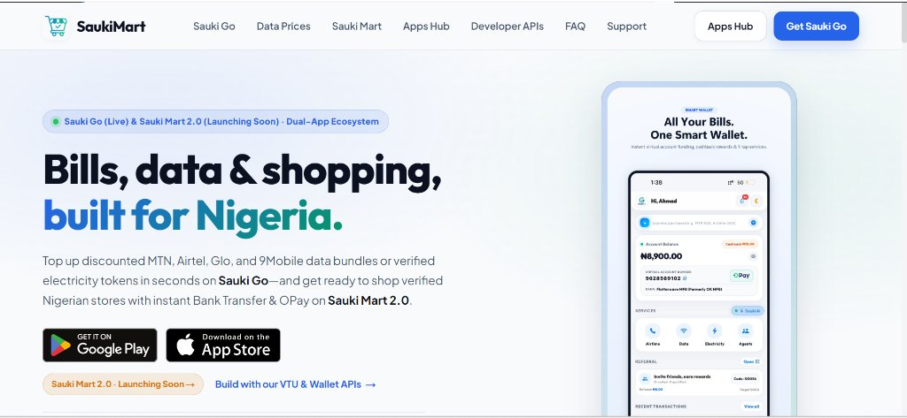
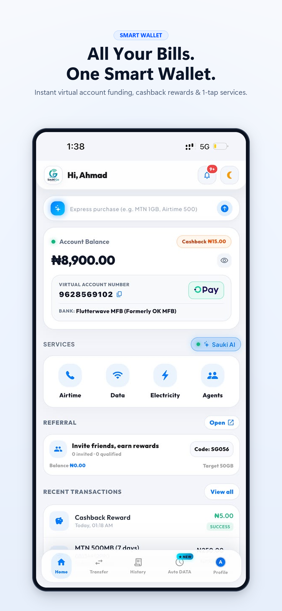
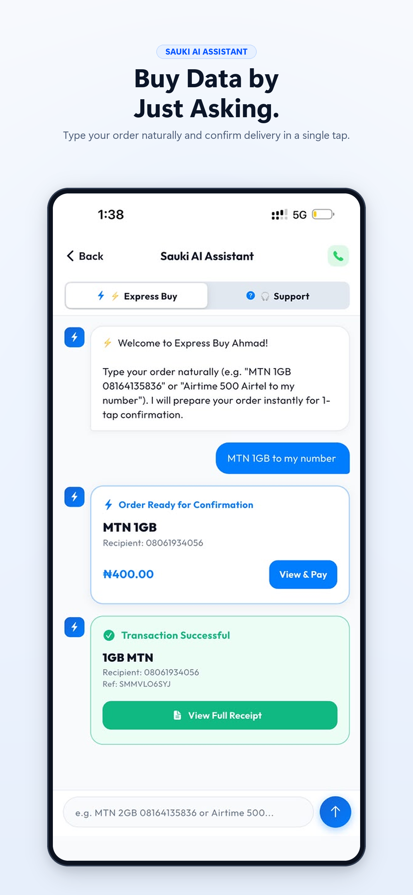
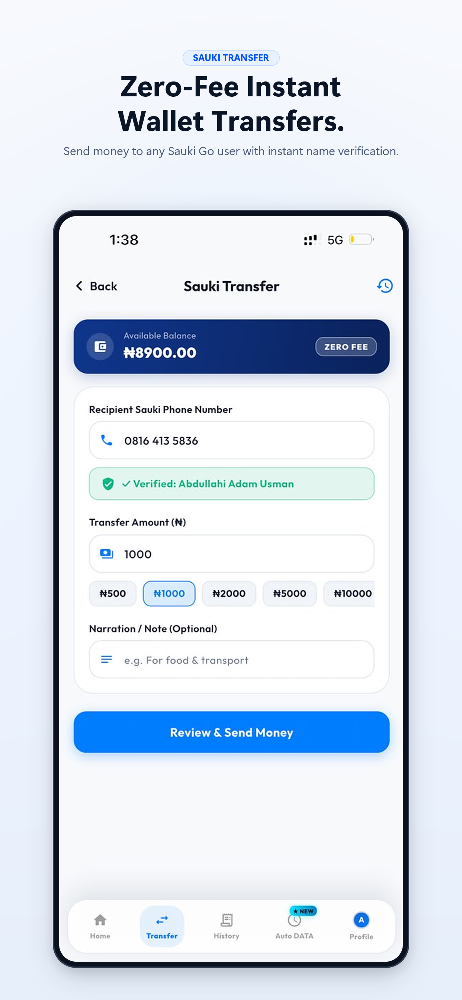
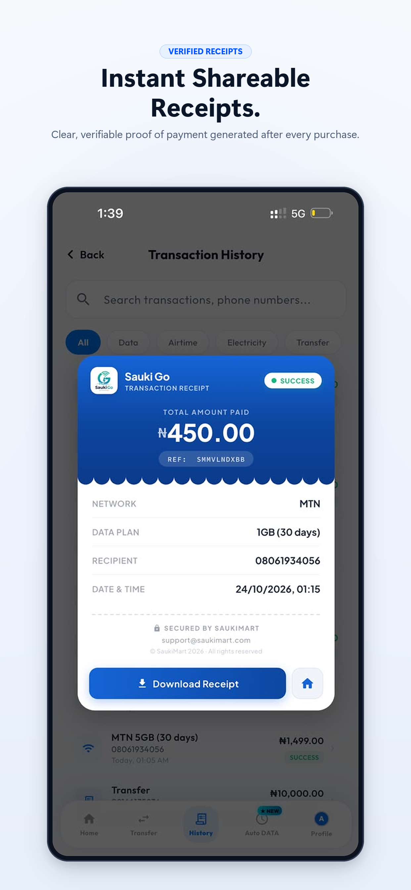
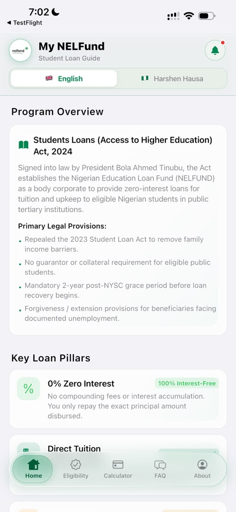
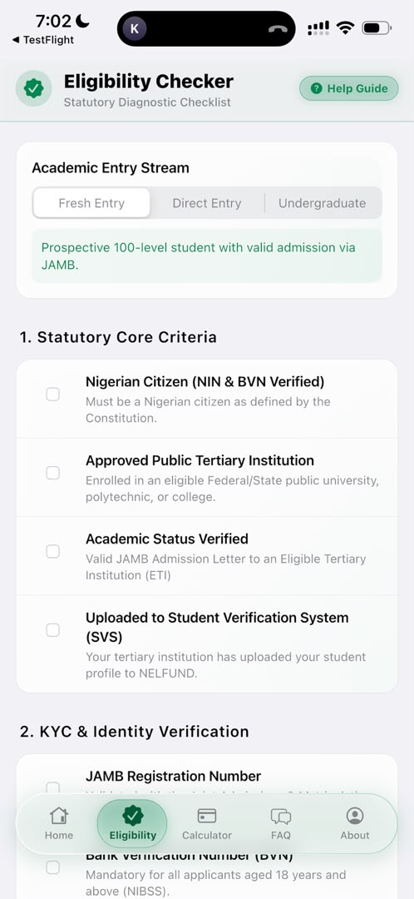
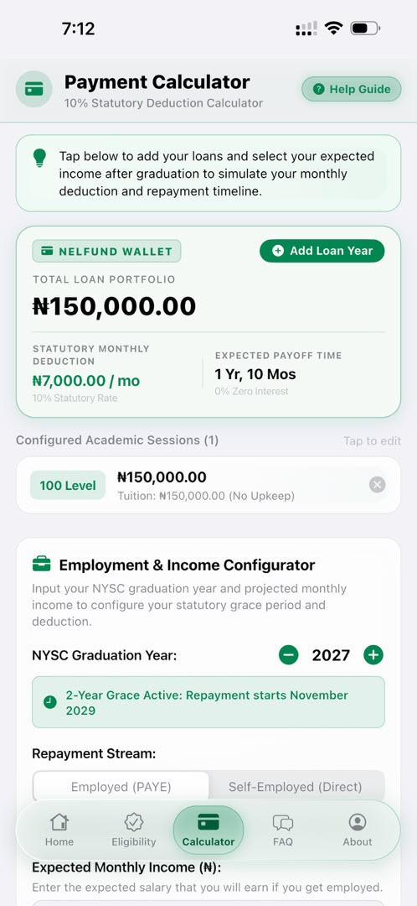
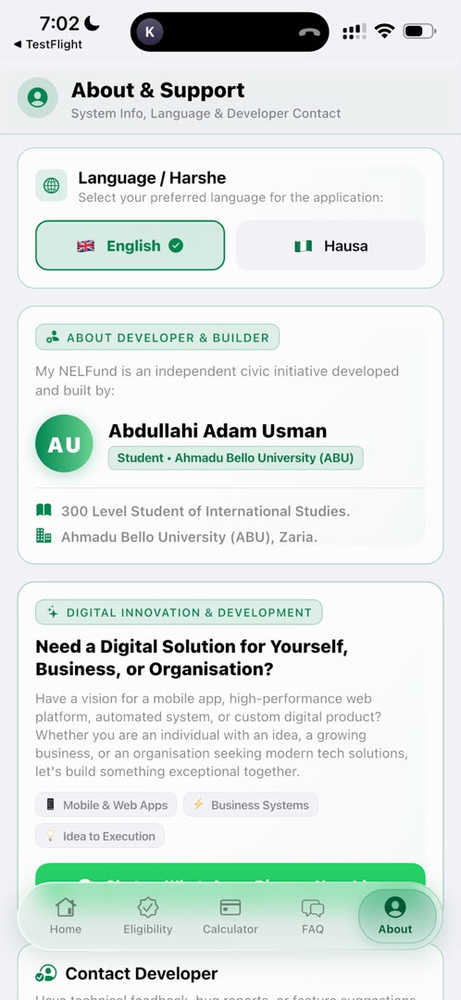

# Hi, I'm Abdullahi Adam Usman (`Abdallahnangere`)

Full-stack mobile & backend engineer (and 300-Level International Studies student at Ahmadu Bello University, Zaria) building production fintech, e-commerce, and civic software—**leveraging agentic development and AI capabilities to deliver efficient, high-craft results**.

> *Most of my commercial products live in private repositories—this page showcases the live apps, verified engineering benchmarks, and open-source data/mobile projects you can inspect and run today.*

> **Open for Collaborations, Contract Works & Hiring:** Available for Flutter mobile engineering, Next.js/FastAPI backend systems, and AI-assisted product delivery. Reach out via [Email](mailto:abdallah@saukimart.com), [WhatsApp (`+2348164135836`)](https://wa.me/2348164135836), or call `+2348164135836`.

---

## Tech Stack & Capabilities

-4169E1?style=for-the-badge&logo=postgresql&logoColor=white)

---

## Featured Shipped Products & Open-Source Work

### 1. Sauki Go — Smart Wallet, Bills & AI Express VTU *(Live on Stores · Private Repo)*

A native Flutter financial & VTU app (`88` Dart files, `142` commits) powered by the `APP-Final` Next.js 14 / Neon PostgreSQL / Firebase / Flutterwave backend (`716` commits).

**Key Engineering Feats:**
- **Cold-Boot & Caching Optimization (`dafd632` → `cce002f`):** Unblocked Firebase pre-`runApp()` gating (`0 ms` launch block), reduced splash wait by **68.2%** (`1,100 ms → 350 ms`), built an L1 RAM + L2 `SharedPreferences` cache (**52.95×** faster transaction cache reads in VM microbenchmarks: `1.67 µs` vs `88.42 µs`), and parallelized 4-endpoint home refreshes (**3.06×** faster simulated critical path: `553 ms → 181 ms`).
- **Low-RAM Android OTP Draft Recovery:** Engineered a 20-minute dual-tier encrypted draft engine (`SharedPreferences` + hardware KeyStore via `FlutterSecureStorage` + Android `alwaysRetainTaskState="true"`) paired with idempotent backend responses so switching to SMS apps never wipes onboarding state.
- **"Send When Online" Telco Resilience:** Built an HMAC-signed `retryToken` flow backed by self-chaining Google Cloud Tasks (3-minute retries, atomic lease for zero idle cost, and automatic 24-hour refund safety) for transient carrier outages.
- **Sauki AI & Checkout Safety:** Pre-Gemini local express-buy intent parser for instant airtime/data orders, UUIDv4 idempotency keys + purchase mutexes, 4-digit PIN + biometric lock, and `39` automated Flutter tests.
- **Web Performance (`saukimart.com` — Yellow Lab Tools `A · 94/100`):** `1.12 MB` total page weight, `38` requests, `576` DOM elements, `237 ms` total JS execution time, `0` JS errors, `0` 404s, `0` oversized images, and `0` HTTP/TLS issues.

  

| Smart Wallet Home | Sauki AI Express Buy | Zero-Fee Transfer | Verified Receipt |
| :---: | :---: | :---: | :---: |
|  |  |  |  |

---

### 2. My NELFund — Bilingual Student Loan Guide *(Open Source · Live on Stores)*

An independent, bilingual (**English & Hausa**) Cupertino Flutter utility helping Nigerian tertiary students navigate the **Students Loans (Access to Higher Education) Act, 2024**.

**Verified Production Adoption (Firebase Analytics, Aug 20 – Nov 16, 2026):**
- **5,636** total installs (`first_open`) across **41** countries (`5,420` active users in Nigeria)
- **3,402** peak 30-day active users (MAU) · **1,191** peak 7-day active users (WAU)
- **10,492** loan repayment calculations · **5,643** eligibility audits completed
- **100%** crash-free users on both iOS (`2.2.7`) and Android (`2.2.6`), backed by `15` automated test suites (`68` passing tests)

| Home & Overview | Eligibility Checker | Repayment Calculator | Bilingual & About |
| :---: | :---: | :---: | :---: |
|  |  |  |  |

---

### 3. Sauki Mart 2.0 — Multi-Vendor Commerce App *(Launching Soon · Private Repo)*

Native Flutter multi-vendor marketplace (`79` Dart files, `57` commits) sharing the `APP-Final` commerce & wallet backend:
- Unauthenticated public discovery with staggered masonry product feeds, flash deals, and interactive variant selectors.
- Multi-store grouped cart, Nigerian 36-state + FCT address manager, Flutterwave dynamic virtual account / OPay / Sauki Wallet PIN checkout, and PDF/PNG receipts.

---

### 4. Anjal Islamic Library — Structured Datasets & Headless JSON API *(Open Source)*

A headless, schema-validated dataset pipeline and FastAPI JSON data service (`Python`, `SQLite FTS5`, `JSON Schema Draft 2020-12`, `Vercel`):
- **Datasets:** `6,236` Quran ayahs (`114` surahs), `36,512` Hadith entries (`10` collections), `55,991` Umm al-Qura Hijri date mappings (`1343–1500 AH`), and `836` prayer time entries across all Nigerian cities/LGAs & global hubs.
- **Pipeline:** UTF-8/NFC normalization (`scripts/build_db.py`), automated mojibake scanning (`verify_text_encoding.py`), SHA-256 `manifest.json` verification & JSON/JSONL exporter (`scripts/export_json.py`), OpenAPI `/docs` + `/redoc`, and automated `unittest`/CI verification.

---

## Let's Work Together

Open to **technical collaborations, freelance/contract builds, and engineering roles** (Flutter, Next.js/TypeScript, FastAPI/Python, and AI-accelerated product delivery):

- **Email:** [abdallah@saukimart.com](mailto:abdallah@saukimart.com)
- **WhatsApp:** [+234 816 413 5836](https://wa.me/2348164135836)
- **Phone / Call:** [+234 816 413 5836](tel:+2348164135836)

